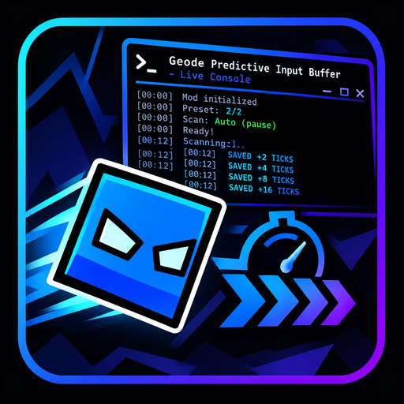

# Template
This is where she makes a mod.



*Update logo.png to change your mod's icon (please)*

## Getting started
We recommend heading over to [the getting started section on our docs](https://docs.geode-sdk.org/getting-started/) for useful info on what to do next.

## Build instructions
For more info, see [our docs](https://docs.geode-sdk.org/getting-started/create-mod#build)
```sh
# Assuming you have the Geode CLI set up already
geode build
```

# Resources
* [Geode SDK Documentation](https://docs.geode-sdk.org/)
* [Geode SDK Source Code](https://github.com/geode-sdk/geode/)
* [Geode CLI](https://github.com/geode-sdk/cli)
* [Bindings](https://github.com/geode-sdk/bindings/)
* [Dev Tools](https://github.com/geode-sdk/DevTools)


## In-game scanning (safe two-stage design)

- While the level is running, the mod incrementally inventories `PlayLayer::m_objects` in bounded batches. This pass only reads object type/disabled flags and never simulates physics or triggers.
- The console reports start, 10% progress steps, and completion with counts for hazards, solids, slopes, orbs, pads, state-changing objects, disabled objects, and decorations.
- If the loaded object-array size changes, the partial pass is discarded and retried; repeated changes stop the scan rather than indexing a stale array.
- The route search remains a separate stage that starts on pause. This is intentional: the route simulator touches shared game-object state, so running it against the live moving level would risk desynchronizing actual gameplay.
- `tests/live_scan_tests.cpp` checks the bounded scanner and its abort/restart boundary. `tests/live_scan_simulation.cpp` prints an example using 25,000 synthetic objects; it does not launch Geometry Dash or certify collision accuracy.
